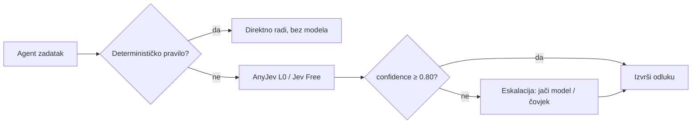

# Decision Intelligence — BH-Decision skill, MCP i OpenCode plugin

[](LICENSE)
[](#provjera)
[](docs/benchmarking/anyjev-comparison.md)

Kalibrirano odlučivanje za AI agente: **skill** (`decision_*` MCP alati) +
**MCP server** (stdio) + **OpenCode plugin** (`/decision`, `/decision-risk`,
`/decision-rank`, `/decision-status`) + zajednički **Core** bez ovisnosti o provideru.
Bosanska ijekavica + engleski. Bez plaćenih poziva po defaultu, bez slanja repozitorija
ili tajni provideru. Nosioci: Kolektiv d.o.o. + Gamatrade d.o.o. Kontakt: xnetba@gmail.com.

> Pripada projektu [BH-Decision](https://github.com/BH-Language-AI/bh-decision)
> (trening modela za odlučivanje); ovaj repo je samo operativni skill paket.

## Zašto agent radi bolje i brže / Why better and faster

Bez skilla agent svaku mikro-odluku (klasifikacija, izbor alata, procjena rizika)
donosi punim reasoningom glavnog modela: sporo, skupo i bez kalibracije — model je
samouvjeren i kad griješi (Jev vraća confidence 1.0 i na pogrešnim odgovorima,
izmjereno). Sa skillom odluka ide brzom L0 putanjom s pragovima povjerenja:



**Brže:** L0 je jedan forward (Tacit, CPU) ili jedan hosted poziv (Jev, p50 256 ms);
harness overhead je reda milisekundi (mock p50 8 ms). Teški reasoning se pali samo
kad je opravdan (adaptive), a na mjerenom setu se nije morao paliti nijednom (cot 0/18).
**Bolje:** svaka odluka nosi kalibrirano povjerenje; ispod praga slijedi eskalacija
umjesto nagađanja, a `requires_escalation` nikad ne zaobilazi dozvole za destruktivne akcije.

Operativna politika: 1) deterministička pravila prije modela. 2) AnyJev L0 za brze
odluke. 3) Jev Free kao primarna hostirana ruta. 4) Adaptive samo uz opravdanje.
5) Clef lokalno kao fallback. 6) Složenost glavnom agentu. 7) Bez dokaza → abstiniraj.
8) Vjerojatnost ≠ istina. 9) Dozvole uvijek važe.

## Izmjereno, ne obećano / Measured, not promised (18 scenarija, 9 bs + 9 en)

| Ruta | Točnost | Rerun 13.11. | p50 rerun | Reproducibilnost |
|---|---|---|---|---|
| A Jev-1.13-Free (hosted, $0) | 14/14 (100%) | **14/14** | 256 ms | bit-za-bit ✓ |
| B AnyJev Decider L0 (Tacit-4B, CPU) | 11/14 (79%) | **11/14** strogo | 17,1 s | 18/18 identično ✓ |
| C AnyJev Tacit L0 (CPU) | 11/14 norm. | **9/14** strogo (= 11 norm.) | 6,4 s | 18/18 identično ✓ |
| D Tacit Adaptive | 11/14 | nije ponavljan (D==C dokazano, cot 0/18) | — | — |
| E Clef lokalno | — | blokirano (treba GPU/download) | — | — |

Kalibracijski nalazi: Jev daje degenerirane 0/1 distribucije dok je Tacit glađi — na
`ambiguous-*` se ne slažu, oba samouvjerena svaki na svoju stranu; default `tau=0.5`
rijetko okida adaptive; apstinencijski prag 0.40 se ne okida na ovom setu.
Sirovi rezultati: `benchmarks/reports/live-*.json`. Metodologija:
`docs/benchmarking/anyjev-comparison.md`, `docs/benchmarking/methodology.md`.

### A/B testovi: model sam vs model + skill (HTML izvještaji)

| Test | Set | Tačnost A → B | Pozivi | Vrijeme | Izvještaj |
|---|---|---|---|---|---|
| v1 | 13 zadataka, Jev | 92,3% → 100% | 13 → 8 | −19% | `benchmarks/reports/ab-v1-20261113.html` |
| v2 | 30 zadataka, Jev | 89,3% → 89,3% | 30 → 19 | −38% | `benchmarks/reports/ab-v2-20261113.html` |
| v3 | 52 zadatka, Jev (paired 46*) | 84,8% → 93,5% | 46 → 31 | −29% | `benchmarks/reports/ab-v3-20261113.html` |
| v4 | ista 52, lokalni Tacit-4B CPU | 72% → 80% | 52 → 37 | −57% | `benchmarks/reports/ab-v4-20261113.html` |

*6 zadataka palo na mrtvi API ključ, isključeni iz obje grane. Sirovi JSON + runneri:
`benchmarks/reports/ab{,2,3,4}-20261113.json`, `scripts/ab_compare{,2,3,4}.py`, generator izvještaja `scripts/ab_report.py`.

## Struktura / Layout

```
skills/decision-intelligence/  SKILL.md — operativna pravila (kada DA / kada NE)
packages/decision-core/        normalizacija, registar, fallback, dedup/keš/breaker/budžet, metrike
packages/decision-mcp/         14 alata decision_* — stdio transport
packages/opencode-plugin/      skill+MCP registracija, /decision /decision-risk /decision-rank /decision-status
config/                        decision.example.yaml, providers.example.yaml (tajne samo kroz env!)
docs/                          arhitektura, provideri, odluke, instalacija, benchmark
benchmarks/                    scenariji + sirovi izvještaji (sve brojke iz stvarnih runova)
scripts/                       bench runneri + lokalni AnyJev bridge (reprodukcija mjerenja)
tests/                         45 TS testova (bez ključeva i mreže)
```

## Instalacija (OpenCode)

1. Zavisnosti: `npm install --prefix packages/decision-mcp` i
   `npm install --prefix packages/opencode-plugin` (`decision-core` nema zavisnosti).
2. Skill: kopiraj `skills/decision-intelligence/` → `.opencode/skills/` (projektni)
   ili `~/.config/opencode/skills/` (globalni).
3. MCP server — opcija A (preporučeno): dodaj `packages/opencode-plugin` u `plugins`
   listu `opencode.json`; plugin sam registrira lokalni MCP server `bh-decision`.
   Opcija B (ručno): `node --experimental-strip-types packages/decision-mcp/src/index.ts`
   s env `DECISION_CONFIG=<putanja>/decision.json`.
4. Konfiguracija kroz env: `DECISION_PROVIDER`, `DECISION_FALLBACK`,
   `DECISION_ALLOW_PAID` (default `false`); ključevi samo kroz env (`OPENCODE_API_KEY`).
5. Provjera: `/decision-status` ili `decision_status` MCP alat. Zahtjevi: Node ≥ 22.

Detalji: `docs/installation/opencode.md`, `docs/installation/local-clef.md`.
Privatnost: `docs/security/privacy.md`.

## Ručne komande

- `/decision [provider=<id>] <zadatak>` — namjera + složenost.
- `/decision-risk [provider=<id>] <zadatak>` — nivo rizika + treba li odobrenje.
  Primjer: `/decision-risk obriši staru bazu` → `risk_level=high … ESCALATE`.
- `/decision-rank [provider=<id>] <zadatak> | opt1, opt2, opt3` — poredak opcija
  (min. 2, dijele se zarezom). Primjer: `/decision-rank trebam alat za pretragu | grep, glob, websearch`.
- `/decision-status` — zdravlje providera i statistika.

MCP alati (za agente): `decision_classify`, `decision_route`, `decision_select_tool`,
`decision_assess_complexity`, `decision_assess_risk`, `decision_rank`, `decision_score`,
`decision_confidence`, `decision_should_escalate`, `decision_status`, `decision_benchmark`,
`decision_anyjev_status`, `decision_anyjev_config`, `decision_anyjev_test`.

## Provjera

```bash
node --experimental-strip-types --test tests/core/normalize.test.ts tests/core/providers.test.ts tests/core/anyjev.test.ts tests/mcp/server.test.ts tests/plugin/loading.test.ts tests/integration/project.test.ts
python3 scripts/live_jev_bench.py benchmarks/scenarios/anyjev-live.jsonl out.json 10 60   # ruta A, treba OPENCODE_API_KEY
```

## Licenca

Apache License 2.0 — vidi [LICENSE](LICENSE). Historija odluka: [CHANGELOG.md](CHANGELOG.md).
